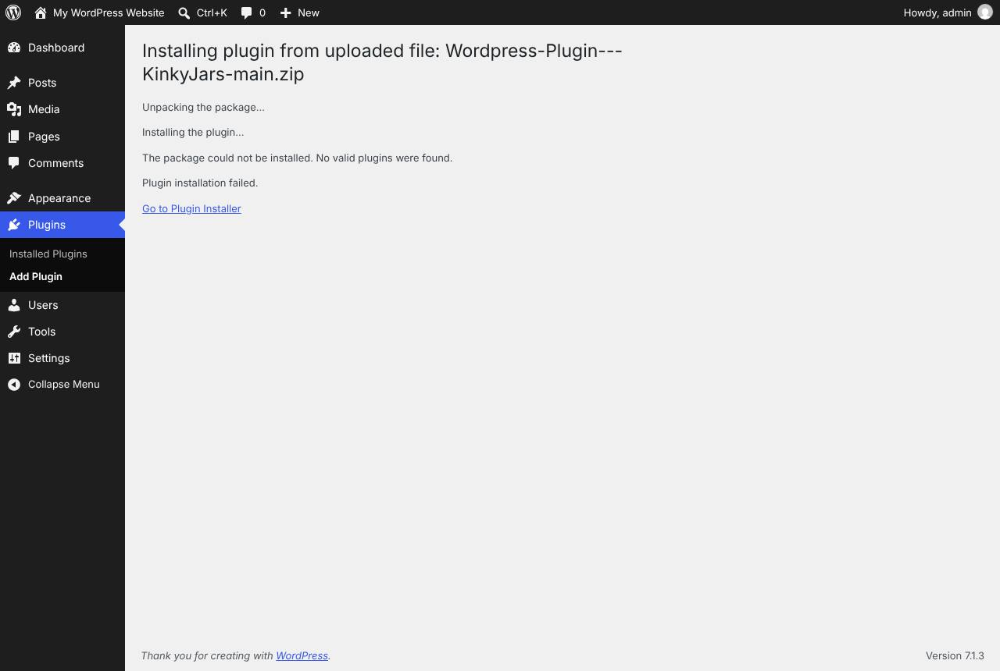
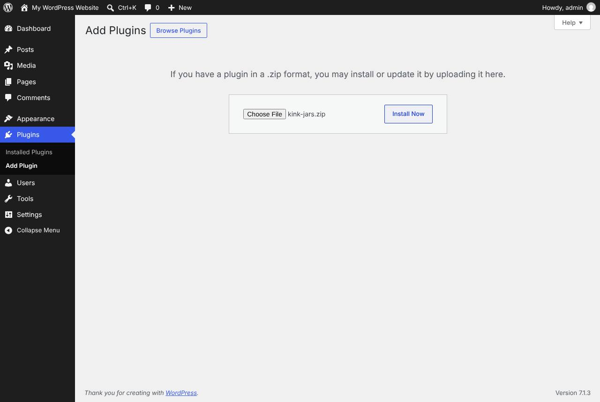
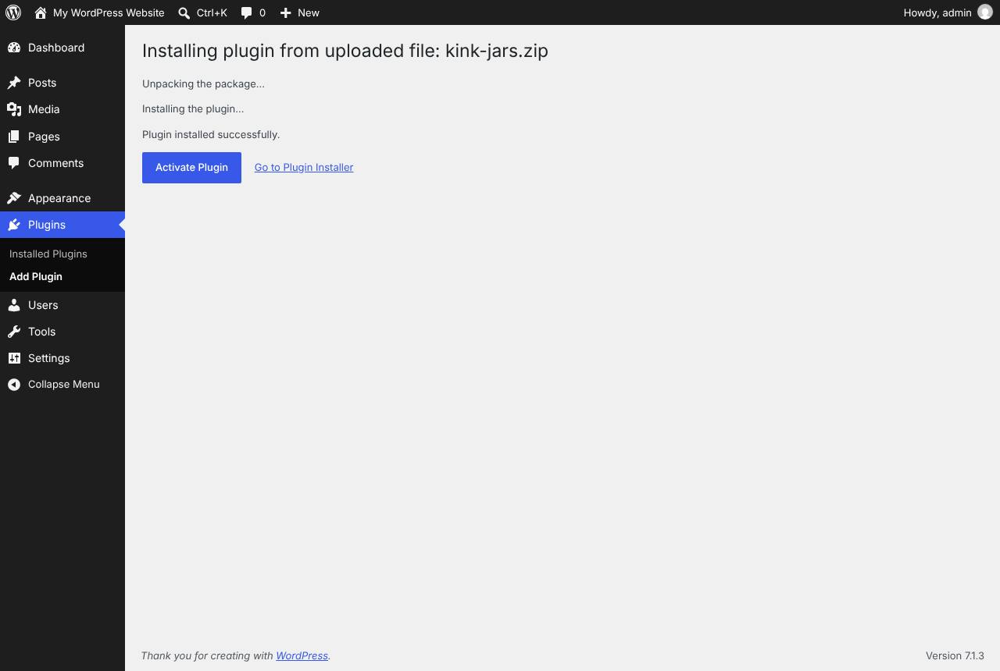
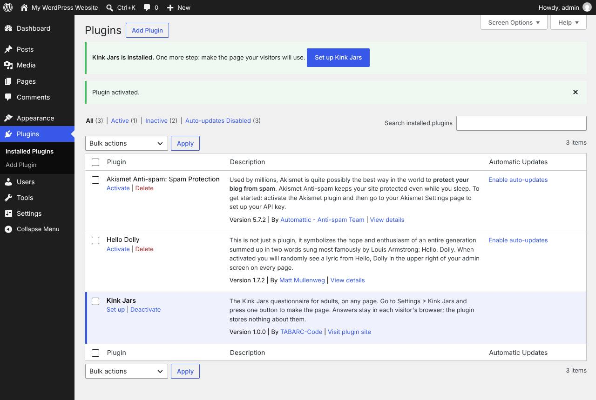
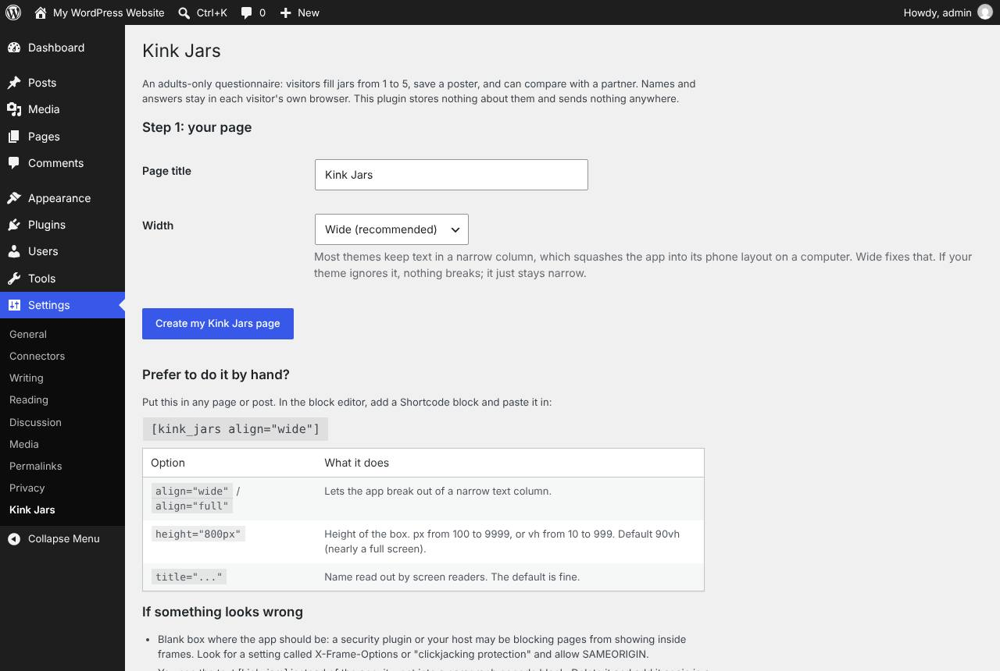
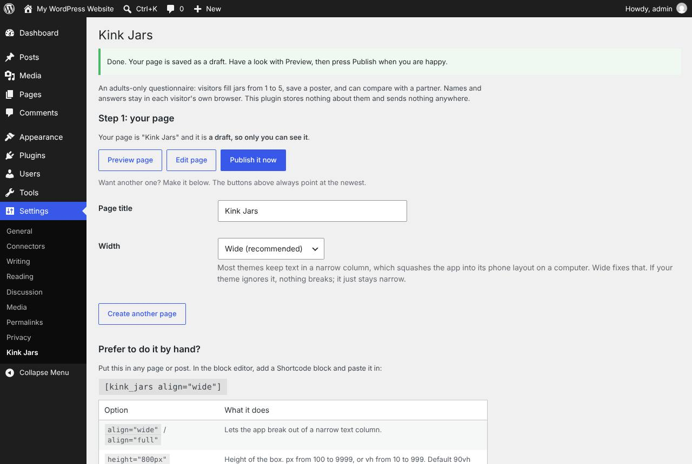
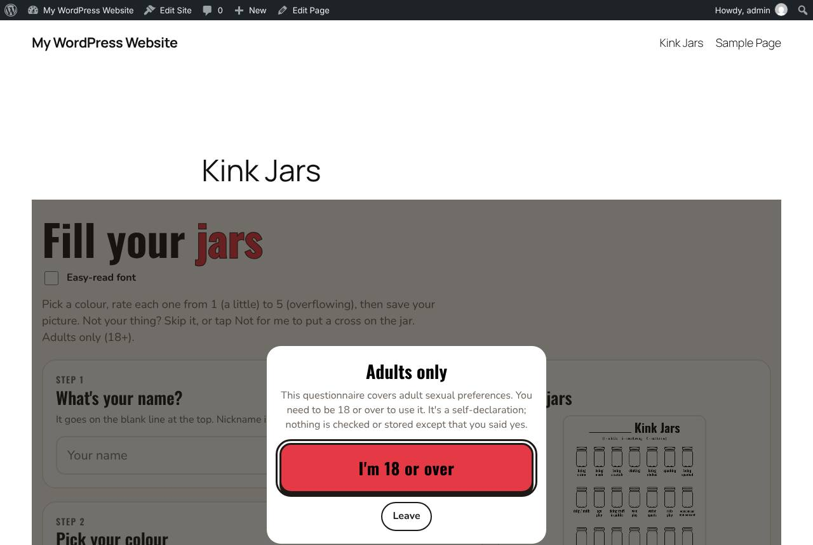
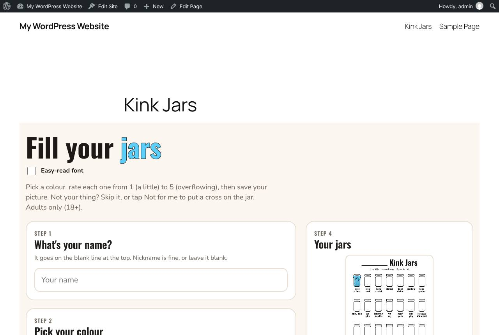

# The idiot's guide to installing Kink Jars

No offence meant by the title. It's the guide I'd want if I'd never installed a WordPress plugin by hand before: every click, in order, with pictures. The pictures come from a real WordPress 7.1.3 install, taken by the automated test that runs these exact steps on every change. If a screen ever stops matching, the test fails before you see it. That's the theory, anyway.

You'll need about ten minutes. You won't need any code, a terminal, or FTP.

---

## Before you start: can your site take plugins?

You need two things:

1. **A WordPress site where you're an Administrator.** If you can see **Plugins** and **Settings** in the black menu down the left-hand side after logging in, you're fine.
2. **Permission to upload plugins.** Go to **Plugins > Add Plugin**. If there's an **Upload Plugin** button at the top, you're good. (Older WordPress calls the menu item **Add New** instead. Same thing.)

No Upload Plugin button? The usual reasons:

- **WordPress.com** (the hosted service, not WordPress the software) only allows your own plugins on its paid plans that include plugins. Their plan names change, so check their current pricing page rather than trusting me.
- Your **web host or whoever set the site up** has switched uploads off. Ask them. They'll either turn it on or install the zip for you.

---

## Step 1: download the right file

Download this file:

**https://github.com/TABARC-Code/Wordpress-Plugin---KinkyJars/releases/latest/download/kink-jars.zip**

That link always gives you the newest version. It's a small file, roughly 160 KB.

Two traps here, and between them they cause most of the "it won't install" moments:

**Don't use GitHub's green Code button or the "Source code" downloads.** They contain the whole project (tests, scripts, this guide) wrapped in an extra folder, and WordPress turns them down flat with this:

If you see that message, you've got the wrong zip. Go back to the link above.

**Don't unzip it.** WordPress wants the zip as it is. If you're on a Mac using Safari and you've ended up with a folder called `kink-jars` instead of `kink-jars.zip`, Safari has "helpfully" unzipped it for you. Either right-click the folder and choose **Compress "kink-jars"** (that makes a zip WordPress is happy with), or download it again in another browser.

---

## Step 2: upload and install

1. Log in to your WordPress admin. That's usually your site's address with `/wp-admin` on the end, for example `https://example.com/wp-admin`.
2. In the left-hand menu, go to **Plugins > Add Plugin**.
3. Press **Upload Plugin** at the top.
4. Press **Choose File** and pick the `kink-jars.zip` you downloaded.
5. Press **Install Now**.

After a few seconds you should see **Plugin installed successfully.**

6. Press **Activate Plugin**.

---

## Step 3: open the setup page

You'll land on the Plugins list with a green box at the top saying **Kink Jars is installed.**

Press **Set up Kink Jars**.

Missed it? It doesn't matter. The same page is always at **Settings > Kink Jars**, and there's a **Set up** link under the plugin's name in the Plugins list.

---

## Step 4: make the page

This is the screen that does the work:

- **Page title:** what the page is called on your site. "Kink Jars" is fine, or change it.
- **Width:** leave it on **Wide (recommended)**. Most themes squeeze page content into a narrow column, and the app then shows its phone layout even on a big screen. Wide lets it spread out. If your theme ignores the setting, nothing breaks; it just stays narrow.

Press **Create my Kink Jars page**.

---

## Step 5: check it, then publish

The page is made as a **draft**, so nobody else can see it yet. I did that on purpose. This is adult content, and it shouldn't appear on anyone's site without them looking at it first.

1. Press **Preview page**. It opens in a new tab so you can see exactly what visitors will get.
2. Happy? Come back to this tab and press **Publish it now**.

That's it. You'll see **Published. Your Kink Jars page is live.** and the button changes to **View page**.

---

## Step 6: what your visitors see

The first time someone opens the page they're asked to confirm they're 18 or over:

Then they get the questionnaire itself:

Have a go on your phone as well. On small screens it shows a single column with a save bar along the bottom.

**Getting people to the page.** With most newer (block) themes the page turns up in your site menu by itself; it did in the screenshot above. With older themes you might need to add it under **Appearance > Menus**. Or just share the link: the **View page** button on the setup screen takes you straight there.

---

## If something goes wrong

| What you see | What's probably happening | What to do |
| --- | --- | --- |
| "The package could not be installed. No valid plugins were found." | You uploaded GitHub's "Source code" zip, not `kink-jars.zip`. | Download from the link in Step 1 and upload that. |
| A folder called `kink-jars` instead of a zip | Your browser (usually Safari) unzipped it. | Right-click the folder > Compress, or download it in another browser. |
| No **Upload Plugin** button | Your plan or host doesn't allow plugin uploads. | See "Before you start" above. |
| A page comparing the "Current" and "Uploaded" versions | Kink Jars is already installed, so WordPress is asking before it overwrites. | Press **Replace current with uploaded**. |
| The page shows the text `[kink_jars]` instead of the app | The shortcode ended up in a paragraph or code block, or the plugin is deactivated. | Check the plugin is active. In the page editor, delete the text and add a **Shortcode** block containing `[kink_jars align="wide"]`. |
| A blank box where the app should be | A security plugin or your host blocks pages from appearing inside frames. | Look for a setting called X-Frame-Options or "clickjacking protection" and set it to SAMEORIGIN rather than DENY. SAMEORIGIN still protects you; DENY blocks this plugin too. |
| It looks squashed on a computer | Your theme's content column is narrow. | Edit the page and change the shortcode to `[kink_jars align="wide"]`, or `align="full"` for edge to edge. |
| An old version still shows after updating | Page caching. | Clear your caching plugin's cache, or your host's. |

Still stuck? Open an issue on GitHub and say what you clicked and what you saw. A screenshot saves a lot of guessing.

---

## Updating to a new version

There are no automatic updates, because the plugin isn't on WordPress.org. When a new version comes out:

1. Download `kink-jars.zip` again from the link in Step 1.
2. **Plugins > Add Plugin > Upload Plugin**, choose the file, **Install Now**.
3. WordPress notices it's already installed and shows the current and uploaded versions side by side. Press **Replace current with uploaded**.
4. You should see **Plugin updated successfully.**

Your page and its settings stay exactly as they were. (The test that takes the screenshots checks this too: it uploads the zip twice and makes sure the page still works afterwards.)

## Removing it

**Plugins**, then **Deactivate** under Kink Jars, then **Delete**. That removes the plugin and the one setting it saved (which page it made). The page itself stays, because it's your content. Delete it from **Pages** if you want it gone. Visitors' answers were only ever in their own browsers, so there's nothing on your site to clear up.
